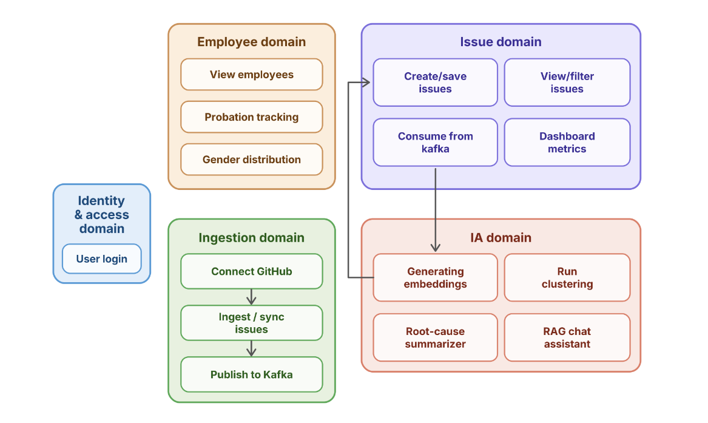
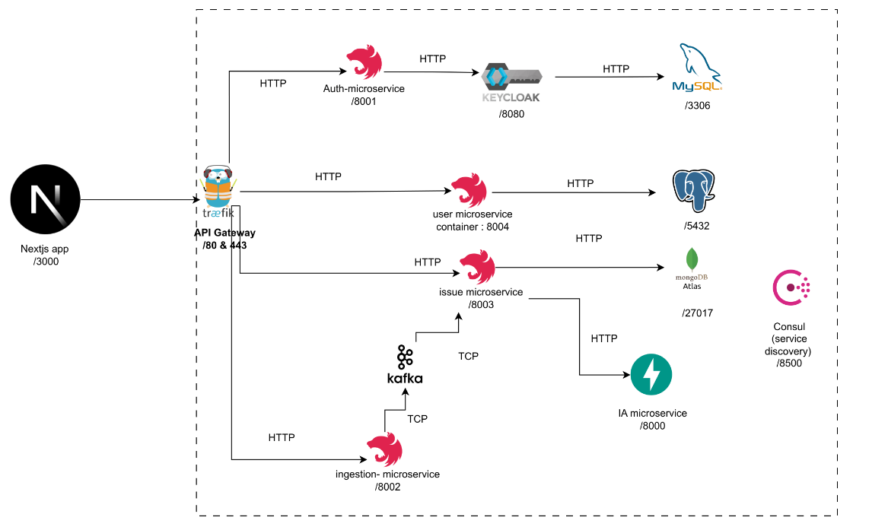
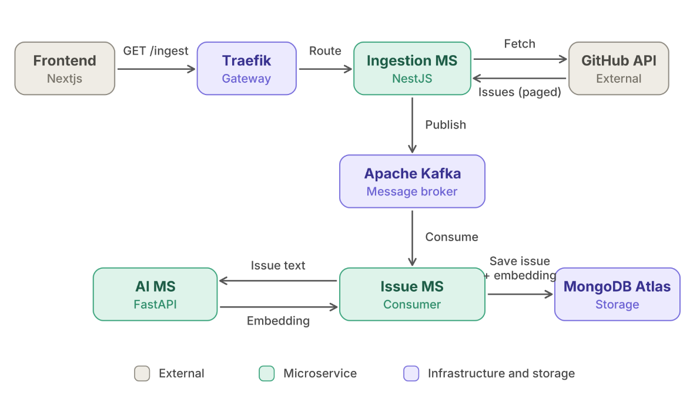
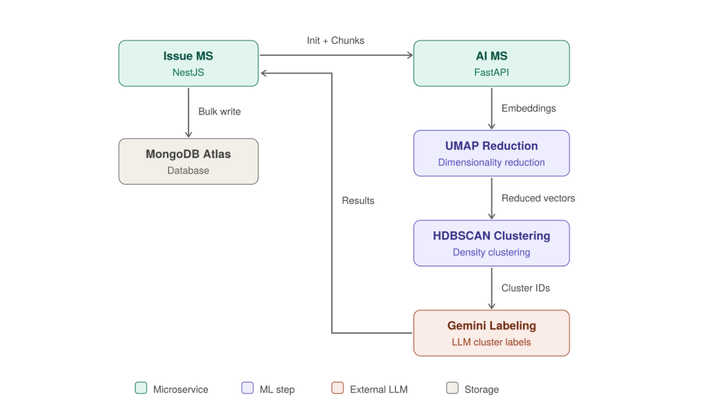
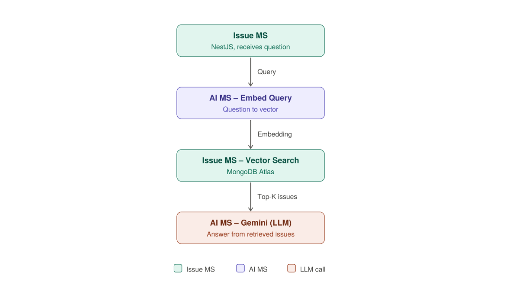
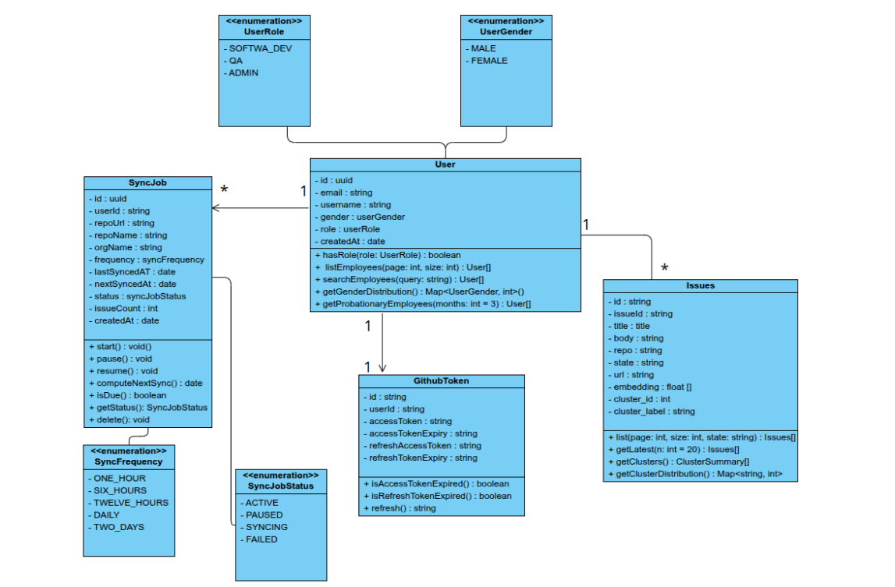

<div align="center">

# 🧠 Smart QA Assistant

**Turn thousands of GitHub issues into actionable insights with AI-powered clustering, duplicate detection and a RAG chat assistant.**


[Demo](#-demo) · [Features](#-features) · [Architecture](#-architecture) · [Tech stack](#-tech-stack) · [Getting started](#-getting-started)

</div>

---

## 📌 About

When a team manages thousands of GitHub issues, three problems appear:

- 🔍 **No visibility** into which problem domains are the most recurring or impactful.
- ⏱️ **Hours lost** manually cross-checking tickets to find duplicates and redundant test cases.
- 📉 **No quality metrics** to measure how well the issue backlog is documented.

Smart QA Assistant solves them by ingesting issues from an organization's GitHub repositories, grouping them into **AI-labeled problem domains**, flagging **duplicates**, measuring **backlog quality**, and letting engineers **chat with their defect history** in natural language.

### Why not use an existing tool?

| Feature                | GitHub duplicate detection |   Atlassian Rovo   | **Smart QA Assistant** |
| ---------------------- | :------------------------: | :----------------: | :--------------------: |
| Duplicate detection    |   At issue creation only   |         ✅         |           ✅           |
| Semantic clustering    |             ❌             |         ❌         |           ✅           |
| AI-generated insights  |             ❌             |         ❌         |           ✅           |
| Dedicated QA dashboard |             ❌             |         ❌         |           ✅           |
| RAG chat assistant     |             ❌             |         ✅         |           ✅           |
| GitHub-native          |             ✅             |         ❌         |           ✅           |
| Free                   |             ✅             | ❌ (premium plans) |           ✅           |

> Comparison reflects the study done during the project. Features of third-party products may have changed since.

---

## 🎬 Demo

> 📹 **Demo video:** [Watch the demo video](https://drive.google.com/file/d/1BBvHmWEmDvkeKvDdfzo39VXfYC61ASt4/view?usp=sharing)

<!--
Pick ONE of the options below and delete the rest:

1) GIF stored in the repo (best for GitHub):
   

2) Click-to-play YouTube thumbnail:
   [](https://www.youtube.com/watch?v=VIDEO_ID)

3) MP4 uploaded by dragging the file into a GitHub issue/PR comment box,
   then pasting the generated https://github.com/user-attachments/... link on its own line.
-->

### What the demo shows

The platform is demonstrated from the point of view of the three actors:

**1. Software Engineer**

- Connect a GitHub account and open the **Issue Intelligence dashboard**: total issues, clustering and noise statistics, main problem domains.
- **Issues** page: browse issues and sync new ones since the last ingestion.
- **AI Insight** page: explore detected problem domains, get an **AI-generated root-cause summary** per cluster, and run the clustering pipeline to discover new clusters.

**2. QA Engineer**

- **Quality dashboard**: poorly described issues and noise.
- **Duplicate detection**: potentially duplicated issues grouped by similarity.
- **Defect Assistant**: ask natural-language questions about the backlog; answers cite the issues they were based on.
- **Repositories** page: configure GitHub synchronization with a cron schedule.

**3. Admin**

- **Dashboard**: employee statistics, role and gender distributions, probationary employees.
- **Employees** page: browse, search and filter the employee list.

## ✨ Features

| Module                   | What it does                                                                                                                              |
| ------------------------ | ----------------------------------------------------------------------------------------------------------------------------------------- |
| **GitHub ingestion**     | Syncs issues from an organization's repositories, manually or on a cron schedule, through an event-driven Kafka pipeline.                 |
| **Semantic search**      | Finds conceptually related issues, not just keyword matches, using embeddings and vector search on MongoDB Atlas.                         |
| **AI clustering**        | Groups issues into problem domains: embeddings → UMAP dimensionality reduction → HDBSCAN clustering → cluster labels generated by Gemini. |
| **Root-cause summaries** | Generates a summary of the likely root cause of a cluster, so nobody has to read every issue.                                             |
| **Duplicate detection**  | Shows potentially duplicated issues grouped together.                                                                                     |
| **Quality metrics**      | Tracks noise rate, clustered rate and resolution rate, and flags poorly described issues.                                                 |
| **RAG chat assistant**   | Answers natural-language questions about the backlog using only the most relevant retrieved issues, and shows its sources.                |
| **Identity & access**    | Authentication and role-based access (Software Engineer, QA Engineer, Admin) with Keycloak.                                               |
| **Administration**       | Paginated employee list, role filter, gender distribution chart, probationary employee tracking.                                          |

---

## 🏗️ Architecture

The system is split into **5 logical domains**: Identity & Access, Employee, Ingestion, Issue and AI.



At the physical level, a **Next.js** frontend talks to the backend through the **Traefik** API Gateway. The backend is a set of **NestJS** microservices plus a **FastAPI** AI service, with **Keycloak** for authentication, **Kafka** for event-driven communication and **Consul** for service discovery.



### Services in this monorepo

Everything runs behind **Traefik** and is orchestrated with Docker Compose. Ports below are the host ports defined in `docker-compose.yaml`.

| Service                  | Role                                                                  | Traefik route    |
| ------------------------ | --------------------------------------------------------------------- | ---------------- |
| `auth-gateway`           | Authentication entry point (Keycloak integration)                     | `/auth`          |
| `ingestion`              | Fetches issues from GitHub and publishes them to Kafka                | `/ingestion`     |
| `issues`                 | Consumes issues from Kafka, stores them, serves dashboards and search | `/issues`        |
| `users`                  | User and employee management (PostgreSQL)                             | `/users`         |
| `notifications`          | Consumes mail events from Kafka                                       | `/notifications` |
| `smartqa-vector-service` | FastAPI AI service: embeddings, clustering, RAG                       |                  |

**Infrastructure containers:** Apache Kafka, MongoDB Atlas Local (vector search), PostgreSQL 17, MySQL 8 (Keycloak database), Keycloak, Consul, Traefik v3.6 with a JWT middleware plugin, plus Mongo Express and pgAdmin as dev tools.

### Flows

<details>
<summary><b>Ingestion flow</b>: from GitHub to the database</summary>

The frontend triggers an ingestion, Traefik routes it to the Ingestion service, which fetches issues from GitHub and publishes them to Kafka. The Issue service consumes each message, gets an embedding from the AI service and stores both in MongoDB Atlas.



</details>

<details>
<summary><b>Clustering pipeline flow</b>: grouping issues into problem domains</summary>

The Issue service sends issues to the AI service in chunks. The AI service reduces dimensions with **UMAP**, clusters with **HDBSCAN**, and **Gemini** labels each cluster. Results are written back to MongoDB Atlas.



</details>

<details>
<summary><b>RAG chat flow</b>: answering questions about the backlog</summary>

The question is turned into an embedding by the AI service. The Issue service runs a semantic search on MongoDB Atlas and retrieves the most relevant issues. The issues and the question are sent to Gemini, which is instructed to answer **only** from them.



</details>

<details>
<summary><b>Class diagram</b></summary>

At the center is the `User`, who has a `GithubToken`, `SyncJobs` controlling repository synchronization, and many `Issues`, enriched with embeddings and cluster information to power semantic search and clustering.



</details>

---

## 🎯 Non-functional requirements

| Quality         | How it is achieved                                                                                                                                                |
| --------------- | ----------------------------------------------------------------------------------------------------------------------------------------------------------------- |
| **Scalability** | Event-driven ingestion with Kafka separates GitHub synchronization from the rest of the processing, so each service scales independently.                         |
| **Reliability** | Kafka offsets are committed only after successful processing, so temporary failures don't cause data loss.                                                        |
| **Performance** | Paginated and indexed MongoDB queries (no full-collection scans) keep the app responsive with **18,000+ issues**. UMAP reduces dimensions to speed up clustering. |
| **Security**    | RS256-signed JWTs and secure `HttpOnly` cookies.                                                                                                                  |

---

## 🧪 Technology choices

Each major choice was benchmarked or compared against alternatives:

| Decision                 | Chosen               | Compared with                    | Why                                                                                                                              |
| ------------------------ | -------------------- | -------------------------------- | -------------------------------------------------------------------------------------------------------------------------------- |
| Clustering               | **HDBSCAN**          | K-Means                          | No need to set the number of clusters, labels noise as `-1`, and a better silhouette score (**0.38 vs 0.29**).                   |
| Dimensionality reduction | **UMAP**             | PCA                              | Handles the non-linear semantic space and scored higher on trustworthiness (**0.91 vs 0.68**).                                   |
| Backend framework        | **NestJS**           | Express, Spring Boot             | Modular and opinionated, native TypeScript, built-in microservices support (Kafka, gRPC, HTTP).                                  |
| API Gateway              | **Traefik**          | Kong                             | Fully open source and Docker-native with automatic service discovery. Kong's open-source edition was discontinued in March 2025. |
| LLM                      | **Gemini Flash API** | GPT / Claude, local LLM (Ollama) | Good balance of speed, cost (free tier) and setup simplicity.                                                                    |
| Methodology              | **Scrum**            | Waterfall, Kanban                | Requirements evolved during the project, and sprints allowed incremental delivery and regular feedback.                          |

---

## 🧰 Tech stack

| Layer                 | Technologies                                                                           |
| --------------------- | -------------------------------------------------------------------------------------- |
| **Frontend**          | Next.js 16+, TypeScript, Tailwind CSS, Zustand, Recharts                               |
| **Backend**           | NestJS (TypeScript microservices), FastAPI (Python AI service)                         |
| **AI / NLP**          | Embeddings, UMAP, HDBSCAN, Gemini API, RAG with semantic vector search                 |
| **Messaging & infra** | Apache Kafka, Traefik (API Gateway), Consul (service discovery), Keycloak (auth)       |
| **Data**              | MongoDB Atlas (issues, embeddings, clusters), PostgreSQL (structured application data) |
| **DevOps & quality**  | Docker, GitHub Actions, GitHub Container Registry, SonarQube Cloud, ESLint, Flake8     |

---

## 🚀 Getting started

### Prerequisites

- Docker and Docker Compose
- A **Gemini API key**
- A **GitHub token** with access to the repositories you want to analyse
- TLS certificates for Traefik in `./certs` and Traefik dynamic configuration in `./dynamic` (both are mounted by the compose file)

### Configuration

Each service reads its own `.env` file, which is not committed. Create one for every service referenced in `docker-compose.yaml`:

```text
auth-gateway/.env
ingestion/.env
issues/.env
users/.env
notifications/.env
smartqa-vector-service/.env
```

<!-- List the variables of each service here (name only, never values). -->

### Run

```bash
# 1. Clone the repository
git clone https://github.com/MedEzzedineBenZbiba/smartQA-monoRepo.git
cd smartQA-monoRepo

# 2. Start everything
docker compose -p smart_qa_microservices up --build
```

---

## 🔄 CI

Every push runs a **GitHub Actions** pipeline:

1. **Lint:** ESLint for TypeScript, Flake8 for Python.
2. **Tests.**
3. **Code quality analysis** with SonarQube Cloud.
4. **Build** Docker images and push them to **GitHub Container Registry**.

---

## 🗓️ Project management

The project followed **Scrum**, with a product backlog split into four epics (Identity & Access Control, Employees Management, AI-Powered Issue Intelligence, Conversational Defect Analysis) delivered across eight sprints:

| Sprint | Scope                                       |
| ------ | ------------------------------------------- |
| 0      | Requirement gathering and high-level design |
| 1      | Authentication and authorization module     |
| 2      | GitHub ingestion module                     |
| 3      | NLP and clustering module                   |
| 4      | RAG-based chat assistant module             |
| 5      | Administration module                       |
| 6      | UI improvement and performance optimization |
| 7      | CI/CD                                       |

---

## 🔭 Roadmap

- [ ] Extend clustering and semantic search to other sources (**Jira**, **Slack**).
- [ ] Strengthen security: XSS prevention and additional protection mechanisms.
